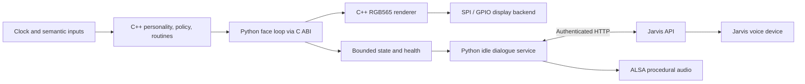

# Sherman

Sherman is a desktop robot project built around a Luckfox Pico Ultra W Linux
board. The current implementation is a stationary character: animated eyes,
local personality and routine logic, and generated audio exchanges with
[Jarvis](https://github.com/dsorensen228/jarvis). This repository also contains
the electronics, component models, and staged plans for adding safe desk motion
and perception. The GitHub copy is a public snapshot of the project; it may be
updated manually.

The longer-term goal is a small robot that explores a desk, maintains a local
map, notices changes, and reports observations to Jarvis. Mapping, autonomous
navigation, and qualified mobile operation remain work in progress.

## What is implemented

| Area | Current contents |
| --- | --- |
| Personality | C++17 emotion model, seeded idle behavior, bounded candidate scoring, and a data-defined routine scheduler. Versioned C bindings expose the runtime to Python. |
| Eyes and display | Python/Pillow reference renderer, C++17 RGB565 renderer, animation scheduling, and a Linux ST7789V2 SPI/GPIO backend for the Waveshare 1.9-inch `320 × 170` display. |
| Face service | Python `ctypes` integration with the native personality and renderer libraries, validated inputs, bounded restart snapshots, health output, and calm-eye fallback on personality failure. |
| Jarvis interaction | A separate Python service requests generated dialogue over authenticated HTTP, synthesizes local droid-like beeps, and coordinates acknowledged speech on a Jarvis voice device. It includes randomized idle scheduling and a manual interaction trigger. |
| Platform tooling | Luckfox Buildroot bring-up records, boot services, deployment scripts with rollback, read-only health checks, and bounded RTSP decode probes. |
| Safety controller draft | Raspberry Pi Pico 2 firmware with a portable control/safety core, bounded UART protocol, sensor drivers, encoder capture, watchdog, and read-only USB diagnostics. Physical motor output is locked off; it has not been flashed or bench-qualified. |
| Hardware design | Wiring/netlist documentation, component envelopes, and a generated two-layer charge-interlock PCB with KiCad, Gerber, drill, BOM, and assembly files. Physical qualification remains separate from file verification. |

The [platform baseline](firmware/linux/luckfox-ultra-w/README.md) records
on-device face operation alongside the vendor SC3336 camera/RTSP pipeline. That
camera bring-up establishes transport; it does not establish calibrated
perception or scene understanding. The
[personality verification record](personality/runtime/RESULTS.md) describes host
and ARM target checks and their limits.

Mobile operation remains unqualified. The [roadmap](docs/roadmap/README.md) tracks
the remaining gates for reproducible firmware images, sensing, motor control,
cliff avoidance, mapping, docking, and
endurance. Body size, battery life, stop latency, and other figures in
[GOALS.md](GOALS.md) are targets pending their acceptance evidence. Much of
`core/`, `vision/`, `navigation/`, `simulation/`, and `websocket/` currently
contains architecture and implementation plans rather than working subsystems.

## How it fits together

The current face path runs locally on the Luckfox. An injected clock and
validated semantic inputs drive the C++ personality runtime; Python schedules
animation and passes the resulting pose to the C++ renderer. The SPI backend
transfers RGB565 pixels to the display. Personality proposes semantic behavior;
it does not command motors.



The dialogue service is independent of face deployment. It checks fresh idle
health, validates generated scripts, and executes each exchange in order.
Explicit quiet, busy, degraded, or disconnected conditions skip work rather than
queue it for later. Automatic exchanges also observe nighttime quiet hours; the
manual trigger can bypass that schedule. Model inference and Jarvis speech run
outside the robot; the local beep synthesizer uses Python's standard library and
ALSA. See the
[dialogue implementation](personality/banter/runtime.py) and
[operating guide](personality/banter/README.md).

The mobile architecture separates a Raspberry Pi Pico 2 safety controller from
the Luckfox. Its [firmware draft](firmware/controller/README.md) implements
host-tested command expiry, fault latching, sensor acquisition, and a synthetic
wheel-speed control loop. The target image keeps motor outputs disabled and
rejects arming. Enabling motion requires further implementation and physical
qualification. It is marked
`BLOCKED-HARDWARE`: board, wiring, sensor, power, and stop-time checks remain open.
The planned Linux safety gateway is also outstanding. See the
[system architecture](docs/architecture/system-architecture.md) and
[controller draft decision](docs/decisions/0009-pico-controller-draft.md).

## Code and design guide

| Start here | What to look at |
| --- | --- |
| [Personality runtime](personality/runtime/) | [Behavior scoring](personality/runtime/src/policy.cpp), [routine scheduling](personality/runtime/src/routine.cpp), and the [C ABI](personality/runtime/include/sherman/personality/runtime_c.h) |
| [Procedural eyes](display/procedural_eyes/) | Reference and native renderers, image fixtures, renderer comparison, benchmarks, and [third-party attribution](display/procedural_eyes/THIRD_PARTY_NOTICES.md) |
| [Face runtime](display/runtime/) | [Native adapter](display/runtime/personality_adapter.py), scheduling, restart state, and [SPI backend](display/backends/st7789.py) |
| [Jarvis schemas](proto/schema/) | JSON Schema contracts for generated dialogue and manual-trigger polling, with [fixtures](proto/fixtures/) |
| [Pico 2 controller](firmware/controller/) | [Safety/control core](firmware/controller/src/controller.cpp), [sensor drivers](firmware/controller/src/sensors.cpp), [wire contract](proto/docs/controller-v1.md), and host fault/contract tests |
| [Luckfox platform](firmware/linux/luckfox-ultra-w/) | Hardware profile, deployment/rollback scripts, service supervision, and fake-target tests |
| [Charge-interlock PCB](electronics/pcb/charging-interlock-rev-a/) | Deterministic Python generator, fabrication outputs, connectivity/clearance checks, and pending bench qualification |
| [Hardware documentation](docs/hardware/) | Component selection, mechanical/power constraints, and qualification protocols |
| [Roadmap and decisions](docs/) | Phase plans, contracts, safety boundaries, and recorded design decisions |

## Try the software without hardware

Use Python 3.11+, a C/C++ compiler with C++17 support, and CMake 3.16+. Pillow
is the reference renderer's only declared runtime dependency. From the repository
root, create a local environment and install it:

```sh
python3 -m venv .venv
. .venv/bin/activate
python -m pip install -e display/procedural_eyes
```

Build and test the native personality and eyes independently:

```sh
cmake -S personality/runtime -B build/personality
cmake --build build/personality
ctest --test-dir build/personality --output-on-failure

cmake -S display/procedural_eyes/cpp -B build/eyes
cmake --build build/eyes
ctest --test-dir build/eyes --output-on-failure
```

Run the reference renderer, face integration, display-backend, and dialogue
unit tests. These use host inputs and fakes; they do not connect to a robot or
Jarvis:

```sh
PYTHONPATH=display/procedural_eyes python -m unittest discover -s display/procedural_eyes/tests
PYTHONPATH=display:display/procedural_eyes python -m unittest discover -s display/runtime/tests
PYTHONPATH=display python -m unittest discover -s display/backends/tests
PYTHONPATH=personality python -m unittest discover -s personality/banter/tests
```

To inspect the eye expressions as an image:

```sh
python display/procedural_eyes/tools/render_gallery.py /tmp/sherman-eyes.png
```

Hardware deployment requires the documented board configuration, cross-compiled
ARM libraries, display wiring, and separately provisioned credentials. Follow
the [platform guide](firmware/linux/luckfox-ultra-w/README.md) and
[dialogue guide](personality/banter/README.md) for those steps. Host test results
do not replace electrical, mechanical, or physical safety checks.

For changes, read [AGENTS.md](AGENTS.md), [CONTRIBUTING.md](CONTRIBUTING.md),
and the relevant subsystem's implementation and testing notes. Work is organized
into [packets](docs/agents/work-packets.md) with explicit ownership and evidence.

## Published snapshots

Development and device releases use a separate Git workflow. GitHub is a manually
updated project snapshot, not the deployment upstream. Two branches preserve
additional work that has not been merged into `main`:

- [Quiet-hours sleep](https://github.com/dsorensen228/sherman/tree/codex/quiet-hours-sleep):
  face sleep, manual wake coordination, and Luckfox clock synchronization.
- [Charge-interlock Rev B](https://github.com/dsorensen228/sherman/tree/codex/charging-interlock-rev-b):
  revised PCB, fabrication files, tests, and component model; physical acceptance
  remains pending.

The public snapshots omit twelve manufacturer CAD downloads whose redistribution
terms have not been confirmed. Original component envelopes and enclosure models
are included. Source URLs and the omitted filenames remain documented in the
[component manifest](models/components/manifest.csv); full model-library validation
requires obtaining those vendor files separately.

Deployment addresses, account identifiers, and machine-specific settings in this public
copy are illustrative placeholders. Supply your own configuration before deploying.
