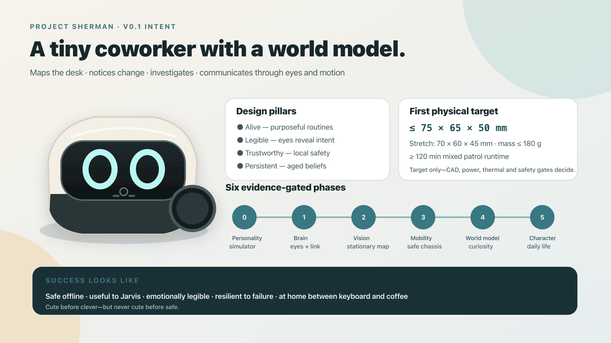

> **Published branch snapshot:** Charge-interlock Rev B design and fabrication files.
> See [the main project overview](https://github.com/dsorensen228/sherman) for repository context.
> Deployment configuration in this public copy uses illustrative values.

# Project Sherman

Sherman is a palm-sized autonomous desktop exploration robot: a persistent, expressive client of Jarvis that maps a workspace, notices changes, investigates objects, and communicates mostly through animated eyes and motion.

This repository begins as an engineering plan. The current target is a `70 mm × 60 mm × 45 mm` robot built around a permanently installed Luckfox Pico Ultra W development board. That envelope is a design target and must pass the mechanical, electrical, thermal, runtime, and safety gates documented under `docs/` before it becomes a committed requirement.

## Start here

1. Read `GOALS.md` for product intent and measurable outcomes.
2. Read `docs/overall-plan.md` for the delivery strategy.
3. Use `docs/hardware/shopping-list.md` for phased procurement and `docs/hardware/display-selection.md` for the selected 1.9-inch landscape face.
4. Read `docs/architecture/system-architecture.md` and `docs/architecture/contracts.md` before changing boundaries.
5. Pick work only from a phase plan or an agent work packet.
6. Follow `AGENTS.md`, including ownership, evidence, and handoff rules.

See the [final-product render](assets/concept/sherman-final-product-render.png) and [desk-context render](assets/concept/sherman-desk-context.png) for artistic intent. They are not dimensional references.

## Hardware names

Project prose uses these two short names consistently:

- **the Pico** means the Raspberry Pi Pico 2 safety controller;
- **the Luckfox** means the Luckfox Pico Ultra W Linux computer.

Never shorten “Luckfox Pico Ultra W” to “the Pico”; that name is reserved for
the Raspberry Pi board.

## Planned repository areas

| Area | Responsibility |
| --- | --- |
| `firmware/` | Board support, device access, boot, supervisors, low-level hardware adapters |
| `core/` | Runtime lifecycle, state, event bus, safety arbitration, behavior scheduling |
| `navigation/` | Localization, occupancy grid, planning, control, docking, recovery |
| `vision/` | Camera ingestion, perception, object tracks, scene-change detection |
| `display/` | Eye renderer, animation system, display driver, visual diagnostics |
| `personality/` | Moods, needs, routines, behavior policy, Jarvis relationship |
| `websocket/` | Secure and resilient Jarvis transport |
| `proto/` | Versioned schemas and compatibility tests |
| `simulation/` | Deterministic world, robot model, sensor models, scenario runner |
| `cad/` | Chassis, mounts, serviceability, tolerances, drawings |
| `electronics/` | Power, motors, sensors, wiring, protection, board-level prototypes |
| `integration/` | Cross-subsystem bring-up, hardware-in-loop, release candidates |
| `tests/` | Shared fixtures, acceptance suites, endurance and system tests |
| `tools/` | Developer utilities, provisioning, capture, replay, analysis |
| `docs/` | Product, architecture, roadmap, decisions, safety, and operations |

## Status

Planning baseline: **v0.1**. No hardware choice beyond the Luckfox Pico Ultra W is frozen. The Waveshare 1.9-inch landscape display and exact motion/sensor/power items are selected qualification candidates, not production releases. All shopping-list entries remain candidates until their gate in `docs/hardware/bom.md` is closed with measurements or vendor documentation.

The current planning set contains six evidence-gated phase plans and subsystem-specific implementation/testing handoffs. Begin swarm execution with `docs/agents/swarm-launch-sequence.md`, not by assigning an entire phase to one agent.
