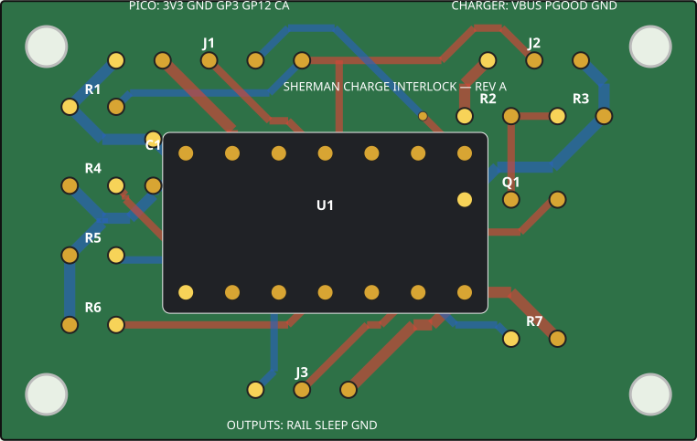

# Sherman Charge-Interlock PCB, Revision A

This 38.10 mm × 24.13 mm two-layer through-hole board is the dedicated compact
implementation of the W1 automatic, redundant charge-present motor inhibit from
ADR 0004. Plugging power into the Adafruit #4755 remains the only V1 charging
action.

**Status:** three bare boards and parts for two populated assemblies were ordered
2026-09-01. Receiving inspection and electrical qualification remain pending.
Installing the board in an unrestrained mobile Sherman is not released until the
bench truth table and power-order fault matrix in
[`electronics/TESTING.md`](../../TESTING.md) pass.



## Ordered fabrication configuration

The OSH Park order used
[`charging-interlock-rev-a-gerbers.zip`](charging-interlock-rev-a-gerbers.zip)
without unpacking it and the following fabrication settings. The selected
service level and final paid total remain in the vendor receipt rather than this
repository.

The submitted-order contents and receiving checklist are recorded in
[`order-manifest.md`](order-manifest.md).

| Setting | Value |
| --- | --- |
| Layers | 2 |
| Size | 38.10 mm × 24.13 mm (detected from the outline) |
| Material | FR-4 |
| Thickness | 1.6 mm / 0.063 inch |
| Copper | 1 oz outer layers |
| Finish | OSH Park ENIG |
| Solder mask / legend | Vendor default; front legend required |
| Assembly | None—bare PCB only |
| Quantity | 3 bare boards ordered; at least 2 good boards required |

Populate two: one for Sherman and one complete tested spare. Keep the third bare
as a fabrication spare unless receiving inspection rejects one of the first two.

The generated layout uses 0.4064 mm signal tracks, 0.6096 mm supply/ground
tracks, 0.3048 mm minimum copper clearance, 0.6096 mm minimum via drill, and
0.8128 mm minimum component drill. These are deliberately conservative relative
to the selected vendor's standard two-layer process.

## Connector pinout—component side, text readable

Square copper pads are pin 1. Do not use ribbon color as identity; continuity
check each completed harness endpoint.

| Connector | Pin 1 | Pin 2 | Pin 3 | Pin 4 | Pin 5 |
| --- | --- | --- | --- | --- | --- |
| `J1 PICO` | Pico pin 36 `3V3(OUT)` | Pico pin 23 GND | Pico pin 5 `GP3` | Pico pin 16 `GP12` | Pico pin 9 `GP6` / `CHARGE_ABSENT` observer |
| `J2 CHARGER` | #4755 `VBUS` | #4755 `PGOOD` | #4755 `GND` | — | — |
| `J3 OUTPUTS` | Pololu #2808-M `CTRL` | DRV8833 `SLP/nSLEEP` | driver/power-gate GND | — | — |

`J1.5` is an input-only observation at the Pico. Firmware must never drive it.
`J2.2 PGOOD` is active-low/open-drain. Q1 supplies a second immediate inhibit
from raw `VBUS`.

## Ordered parts for two populated boards

[`bom.csv`](bom.csv) is the per-board BOM. The ordered and required totals are:

| Part | Needed for 2 | Ordered | Mouser # |
| --- | ---: | ---: | --- |
| TI `SN74HC08N` PDIP-14 | 2 | 2 | `595-SN74HC08N` |
| TE `1-2199298-3` 14-pin DIP socket | 2 | 2 | `571-1-2199298-3` |
| onsemi `2N3904BU` | 2 | 5 | `512-2N3904BU` |
| KEMET `C315C104K5R5TA` 100 nF X7R | 2 | 10 | `80-C315C104K5R5TA` |
| Yageo `MFR-25FRF52-10K` 10 kOhm 1% | 8 | 10 | `603-MFR-25FRF5210K` |
| Yageo `MFR-25FRF52-47K` 47 kOhm 1% | 2 | 10 | `603-MFR-25FRF52-47K` |
| Yageo `MFR-25FBF52-100K` 100 kOhm 1% | 2 | 10 | `603-MFR-25FBF52-100K` |
| Yageo `MFR-25FRF52-4K7` 4.7 kOhm 1% | 2 | 10 | `603-MFR-25FRF52-4K7` |
| Samtec `TSW-140-07-L-S` 2.54 mm male header | 22 positions | 40 positions | `200-TSW14007LS` |

The order covers both PCB assemblies with the stated overage. It does not cover
the four separate 10 kOhm pull-downs at the DRV8833 `AIN1/AIN2/BIN1/BIN2`
inputs; those come from general wiring stock. `R7` on this PCB is already the
4.7 kOhm `SLEEP_EN` pull-down, so do not add a second one at the driver.

The resistors mount vertically at `R1`–`R7`; insulate the folded lead with
heat-shrink if it could touch the resistor body or an adjacent lead. Install the
DIP socket first, align its notch with the U1 outline/notch, and insert U1 only
after resistance and supply-short checks pass. Q1 is the exact onsemi
`2N3904BU`; with its flat face following the board outline, pins are `E-B-C` at
`1-2-3`.

## Assembly and first-power sequence

1. Bare-board inspect both sides; reject shorts, broken annular rings, damaged
   mask, or incorrect outline/drills.
2. With no parts installed, verify no continuity between `3V3`, `VBUS`, and
   `GND`; verify all same-name connector/pad paths from [`netlist.csv`](netlist.csv).
3. Install resistors and C1, then the U1 socket, Q1, and headers. Do not install
   U1 yet.
4. Recheck resistor values in circuit where meaningful and verify no supply
   short. Apply current-limited 3.3 V to `J1.1/J1.2`; confirm the socket supply
   pins are correct, then remove power and install U1.
5. Keep the battery, motor rail, driver `VIN`, and motors disconnected. Perform
   the Section 10 truth table in [`wiring-guide.md`](../../wiring-guide.md).
6. Only after both populated boards pass, label one `SHERMAN` and one `SPARE`
   and record the measurements in the P3-PWR-001 evidence packet.

## Regeneration and verification

[`generate.py`](generate.py) is the editable source of truth. It deterministically
creates the KiCad board, assembly SVG, CSVs, Gerbers, drill files, job file,
verification report, and order ZIP:

```sh
python3 electronics/pcb/charging-interlock-rev-a/generate.py
python3 -m unittest electronics.tests.test_charging_interlock_pcb
```

The generator performs pad/track clearance and full-net connectivity checks.
The order ZIP was also independently parsed as a two-copper-layer stack with
top/bottom mask, front legend, profile, and separate plated/non-plated drills.

References: [TI SN74HC08N](https://www.ti.com/product/SN74HC08/part-details/SN74HC08N),
[onsemi 2N3904 datasheet](https://www.onsemi.com/download/data-sheet/pdf/2n3904-d.pdf),
and [OSH Park two-layer specifications](https://docs.oshpark.com/services/two-layer/).
