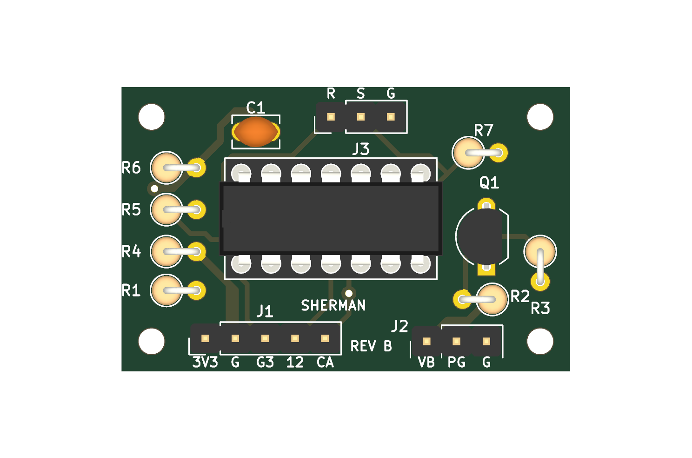
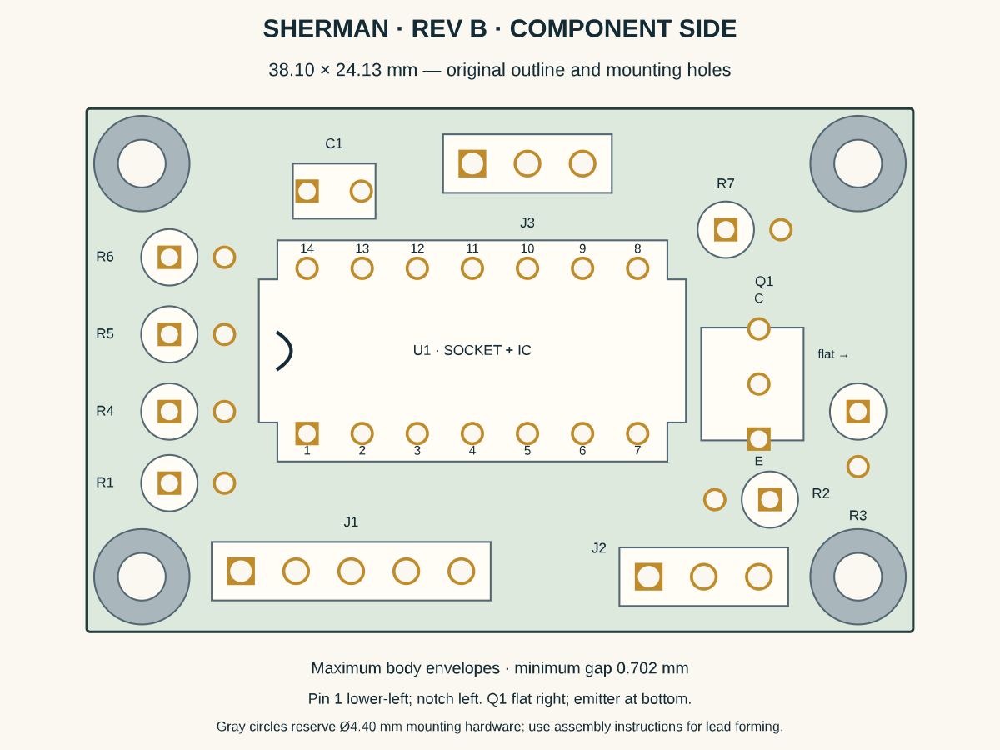

# Sherman charge-interlock Rev B

Rev B replaces the rejected Rev A at **38.10 × 24.13 mm**, with the original
four Ø2.20 mm mounting holes. It reuses the ordered through-hole parts and W1
circuit. U1 now follows the manufacturer's top-view numbering and Q1 is outside
the socket footprint. No component must be installed underneath the socket.

**Status: fabrication design verified; replacement order preparation recorded in
[order-manifest.md](order-manifest.md). Physical qualification is BLOCKED-HARDWARE.**
Do not populate the received Rev A boards. Their mirrored IC footprint and
socket/Q1 interference are documented in ADR 0007.





## Assembly

All parts mount on the component side. Read the board with `REV B` at the bottom.
U1/socket notches face **left**; U1 pin 1 is **lower-left**, pin 7 lower-right,
pin 14 upper-left. Q1's flat face points **right**: top lead C, middle B,
bottom square hole E. Form Q1's outer legs gently to 2.54 mm pitch and leave
3.5 mm below its body. Follow the exact onsemi 2N3904BU pinout.

Mount R1–R7 vertically. The body goes over the square pad: right pad for R2,
upper pad for R3, left pad for all other resistors. Leave about 1.2 mm body
standoff and sleeve the folded return leads so bare leads cannot touch.
C1 is nonpolar. Cut the ordered header strip into 5/3/3 positions per board.

| Ref | Part/value per board |
| --- | --- |
| U1 | TI SN74HC08N, in TE 1-2199298-3 socket |
| Q1 | onsemi 2N3904BU |
| C1 | KEMET C315C104K5R5TA, 100 nF |
| R1, R4, R5, R6 | Yageo MFR-25, 10 kΩ |
| R2 | Yageo MFR-25, 47 kΩ |
| R3 | Yageo MFR-25, 100 kΩ |
| R7 | Yageo MFR-25, 4.7 kΩ |
| J1/J2/J3 | Samtec TSW-140-07-L-S, 5/3/3 positions |

The original parts order covers two assemblies. See [bom.csv](bom.csv) for exact
part numbers and the [Rev A purchase record](../charging-interlock-rev-a/order-manifest.md)
for quantities already ordered. The four driver-input pull-down resistors are
separate from this board. R7 already provides the SLEEP output pull-down.

## Connector map

Pins run left to right with component-side text readable; square pad is pin 1.

| Connector | 1 | 2 | 3 | 4 | 5 |
| --- | --- | --- | --- | --- | --- |
| J1 PICO | Pico pin 36, 3V3 | Pico pin 23, GND | Pico pin 5, GP3 | Pico pin 16, GP12 | Pico pin 9, GP6 / CHARGE_ABSENT |
| J2 CHARGER | #4755 VBUS | #4755 PGOOD | GND | — | — |
| J3 OUTPUTS | #2808-M CTRL | DRV8833 SLP/nSLEEP | GND | — | — |

J1.5 is an input-only observer; firmware must never drive it. J2.2 PGOOD is
active-low/open-drain. Q1 adds inhibition from raw VBUS. U1 pins 8/11 are unused
outputs; pins 9/10/12/13 are grounded. W1 voltage domains and GPIOs are unchanged.

## Receiving and qualification

1. Inspect both sides and confirm `REV B`, correct holes and undamaged copper.
   Dry-fit the socket, IC, Q1 and headers to verify the received parts fit.
2. Before population, use [netlist.csv](netlist.csv) to check same-net continuity
   and isolation among 3V3, VBUS and GND. Inspect for solder-mask/drill defects.
3. Fit resistors and C1, then the socket, Q1 and headers. Keep U1 out. Inspect
   solder joints and formed leads; verify values and no supply short.
4. With motors, motor rail, battery and driver VIN disconnected, supply
   current-limited 3.3 V at J1.1/J1.2. Confirm empty socket pin 14 is 3.3 V and
   pin 7 is GND. Remove power, then insert U1 with notch left.
5. Run the full [Section 10 truth table](../../wiring-guide.md) and
   [power-order/fault matrix](../../TESTING.md), including independent VBUS and
   PGOOD inhibition, resets and loss of power. Record measured outputs/timing in
   P3-PWR-001 before mobile installation. Qualify both SHERMAN and SPARE boards.

The board reserves Ø4.40 mm mounting hardware plus copper clearance. Larger
washers need a separate fit check. The updated enclosure model bounds are
38.10 × 24.13 × 11.78 mm including PCB, socket and IC; add underside solder,
harness plug height and service clearance in the enclosure assembly.

## Verification of the fabrication design

[validation.json](validation.json) records all 44 component pads, 47 plated
holes including 3 vias, 4 mounting holes, 9 routed nets and 2 isolated outputs.
Minimum checked body gap is 0.702 mm; minimum different-net copper clearance is
0.508 mm. KiCad 10.0.6 DRC reports zero violations and zero unconnected items.

The checks use separate mechanisms:

- Official KiCad footprint numbering/transforms and native Gerber export.
- Manufacturer pin diagrams and maximum body envelopes, including the exact
  socket and formed transistor, with foreign-hole and mounting-head access.
- A separate Gerbonara/Shapely reader reconstructs copper connectivity from the
  exported layers and plated drills against [expected-circuit.json](expected-circuit.json).
  Gerber net names are not accepted as connectivity evidence.
- Eight regression tests check the actual board and deliberately corrupt the
  layout/Gerbers. They reject Rev A, mirrored U1 pins, a transistor under the
  socket, an added copper short and a removed GP3 connection.
- OSH Park's own upload parser and rendered layer/board previews are reviewed
  against the same ZIP. Its results are in the order manifest.

These are design/fabrication checks, not a claim of measured electrical operation.
Datasheet sources and tolerances are in [manufacturer-checks.md](manufacturer-checks.md).
Evidence is under `artifacts/phase-3/P3-PWR-003/`.

## Rebuild

Use the PCB-local Python 3.13 environment, KiCad 10.0.6 and its pcbnew-enabled
Python; no repository-wide runtime is required:

```sh
cd electronics/pcb/charging-interlock-rev-b
uv venv --python 3.13 .venv
uv pip sync --python .venv/bin/python requirements.lock
.venv/bin/python build.py --kicad-cli /path/to/kicad-cli --kicad-python /path/to/kicad/python3
.venv/bin/python render-assembly.py
```

On this Mac, the build defaults locate the user-installed KiCad app.
CairoSVG on Homebrew macOS needs `DYLD_FALLBACK_LIBRARY_PATH=/opt/homebrew/lib`.
`build.py` removes a stale ZIP first and recreates it only after all checks pass.
Edit `design.json` and regenerate; do not edit generated boards or Gerber geometry.
The board's UUIDs are stable; KiCad's fabrication timestamps may change on export.
[SHA256SUMS](SHA256SUMS) identifies the exact submitted ZIP and its input files.
`vendor/` contains the licensed footprint snapshot and its checksums.

To regenerate the native populated picture with installed KiCad models:

```sh
kicad-cli pcb render -D KICAD10_3DMODEL_DIR=/path/to/3dmodels --side top --width 1500 --height 1000 --output populated.png charging-interlock-rev-b.kicad_pcb
```

The render uses stock models for illustration; acceptance uses manufacturer
maximum envelopes. `render-assembly.py` also writes the Rev B enclosure SCAD;
rebuild that STL with `models/components/build-mocks.sh` and validate the model library.
