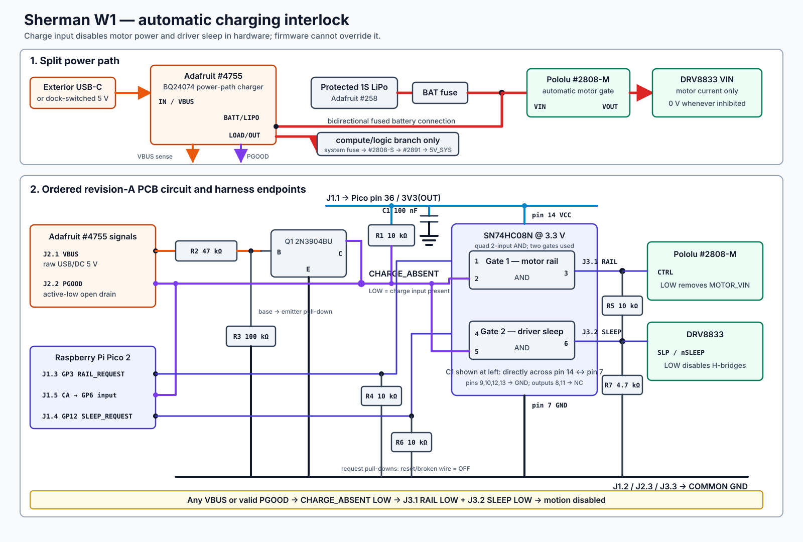

# Sherman Bench Wiring Guide: I2C Hub and In-Place Charging

This is the bench-side version of the full
[`wiring-guide.md`](wiring-guide.md). This version follows the current physical
build: a passive GODIYMODULES I2Chub replaces the breadboard for Pico-side I2C
distribution, and the Adafruit BQ24074 #4755 stays inside Sherman so the
installed battery can charge without opening the robot.

The IMU and both cliff sensors are already wired. Do not take them apart just
to restart this guide. Verify them in Part 2, then continue with the fuel gauge.

## The two board names

- **the Pico** means the Raspberry Pi Pico 2 safety controller;
- **the Luckfox** means the Luckfox Pico Ultra W Linux computer.

“The Pico” never means the Luckfox, even though “Pico” appears in the Luckfox
product name.

## Before touching a wire

Before adding or moving a wire, disconnect all of these:

- the Pico's USB cable;
- the Luckfox's USB cable to build-host;
- the internal battery, but only when building or changing the power harness;
- the dock supply;
- motor power.

Leave the LCD wires and camera ribbon on the Luckfox exactly as they are. Leave
the wheels off. Wiring changes are always made with both boards unpowered.

Dupont jumpers are acceptable for the short, stationary bench logic harness.
They are not acceptable for battery, charger, boost-converter, Luckfox 5 V, or
motor current. Those paths require retained 22 AWG power wiring, keyed
connectors, and the fuses described later.

## Part 1: use the I2C hub instead of a breadboard

Use the Pico with its headers already installed. Use the printed Pico pin
numbers or the official pinout; do not identify a pin only by counting header
positions.

On a Pico held with USB at the top:

- physical pins 1 through 20 run down the left side;
- physical pins 21 through 40 run up the right side.

The I2Chub is a passive distribution board. It makes several physical copies of
the same four electrical connections; it is not a multiplexer and does not
resolve duplicate I2C addresses. Use one hub position as the trunk to the Pico:

| From the Pico | Matching hub bus | Meaning |
| --- | --- | --- |
| Pico physical pin 36, `3V3(OUT)` | `3V3` or `VCC` | Pico-side 3.3 V |
| Pico physical pin 8, `GND` | `GND` | Pico-side ground |
| Pico physical pin 6, `GP4` | `SDA` | Pico I2C0 data |
| Pico physical pin 7, `GP5` | `SCL` | Pico I2C0 clock |

Read the silk beside every pin. Do not assume all four-pin connectors use the
same left-to-right order. The hub must never connect to 5 V or to the Luckfox
3.3 V rail. The front VL53L5CX belongs to a separate Luckfox I2C bus and never
connects to this hub.

With everything unpowered, use continuity mode to confirm that all hub pins
with the same label are common and that `3V3`, `GND`, `SDA`, and `SCL` are not
shorted to one another. Keep each branch short and route SDA, SCL, and ground
together.

## Part 2: verify the three Pico-side sensors already wired

Each sensor uses its own hub position for `VIN`, `GND`, `SDA`, and `SCL`. The
interrupt and shutdown wires bypass the hub and connect directly to the Pico.

### 2A. IMU: Pololu LSM6DSO #2798

| #2798 pin | Destination |
| --- | --- |
| `VIN` | hub `3V3` or `VCC` |
| `GND` | hub `GND` |
| `SDA` | hub `SDA` |
| `SCL` | hub `SCL` |
| `INT1` | Pico physical pin 29 / `GP22` |
| `INT2` or `INT2/DEN` | Pico physical pin 31 / `GP26` |

Leave `CS`, `SDO/SA0`, `SDx`, `SCx`, and `SDO_Aux` disconnected.

### 2B. Left cliff sensor: Pololu VL53L4CD #3692

Put a physical `LEFT` label on this board before wiring it.

| Left #3692 pin | Destination |
| --- | --- |
| `VIN` | hub `3V3` or `VCC` |
| `GND` | hub `GND` |
| `SDA` | hub `SDA` |
| `SCL` | hub `SCL` |
| `XSHUT` | Pico physical pin 24 / `GP18` |
| `GPIO1` | Pico physical pin 26 / `GP20` |

Leave any pin not listed above disconnected.

### 2C. Right cliff sensor: Pololu VL53L4CD #3692

Put a physical `RIGHT` label on this board before wiring it.

| Right #3692 pin | Destination |
| --- | --- |
| `VIN` | hub `3V3` or `VCC` |
| `GND` | hub `GND` |
| `SDA` | hub `SDA` |
| `SCL` | hub `SCL` |
| `XSHUT` | Pico physical pin 25 / `GP19` |
| `GPIO1` | Pico physical pin 27 / `GP21` |

Leave any pin not listed above disconnected.

The two cliff sensors both start at I2C address `0x29`. The hub does not change
that. As its earliest GPIO setup, firmware must drive both XSHUT lines low,
release only the left sensor and assign `0x2A`, then release the right sensor
and assign `0x2B`. It must do this before its first I2C transaction and leave
the motors disarmed on any failure. “Release” means high impedance/input; never
drive XSHUT high.

### 2D. Fuel gauge: Adafruit MAX17048 #5580

Use the pad printed `SDA` on the delivered board for the I2C data connection.

| #5580 pin | Destination |
| --- | --- |
| `VIN` | an unused hub `3V3` or `VCC` position |
| `GND` | the matching hub `GND` position |
| `SDA` | the matching hub `SDA` position |
| `SCL` | the matching hub `SCL` position |

Leave the gauge's battery connector empty for now. The gauge will normally not
answer until a battery is attached later through the fused power tree.

### Check the sensor wiring before power

With the Pico still unplugged:

1. Verify every `VIN` above reaches Pico physical pin 36.
2. Verify every `GND` above reaches Pico physical pin 8.
3. Verify every `SDA` reaches Pico physical pin 6 and not pin 7.
4. Verify every `SCL` reaches Pico physical pin 7 and not pin 6.
5. Verify hub `3V3` is not shorted to hub `GND`.
6. Verify the left and right XSHUT/GPIO1 wires reach the different Pico pins
   listed above.
7. Measure and record resistance from hub `SDA` to hub `3V3`, then from hub
   `SCL` to hub `3V3`. The hub and carrier boards may contain pull-ups, so this
   check matters.

This is the first useful pause point. A clear overhead photo here lets the
wiring be checked before the Pico is powered.

## Part 3: connect encoders to the disconnected Pico

Use the two Pololu #4762 six-wire motor cables. Label one `LEFT` and one
`RIGHT`. For this part, connect only the four encoder wires. Keep every red and
black motor wire individually insulated and disconnected.

### Left encoder cable

| Cable color | Destination |
| --- | --- |
| green | unused hub `GND` position |
| blue | unused hub `3V3` or `VCC` position |
| yellow | Pico physical pin 19 / `GP14` |
| white | Pico physical pin 20 / `GP15` |
| red | no connection yet |
| black | no connection yet |

### Right encoder cable

| Cable color | Destination |
| --- | --- |
| green | unused hub `GND` position |
| blue | unused hub `3V3` or `VCC` position |
| yellow | Pico physical pin 21 / `GP16` |
| white | Pico physical pin 22 / `GP17` |
| red | no connection yet |
| black | no connection yet |

Using the hub for these two low-current encoder supply pairs is only power
distribution. The encoders are not I2C devices: leave the corresponding hub
SDA and SCL pins unused. The red and black motor wires still never touch the
hub.

## Part 4: connect only the motor driver's logic side

The motor driver is the Pololu DRV8833 carrier #2130. Its motor-supply pin,
motor outputs, and motors remain disconnected throughout this part.

First make the simple logic wires:

| DRV8833 pin | Destination |
| --- | --- |
| `GND` | Pico physical pin 13 / `GND` |
| `AIN1` | Pico physical pin 11 / `GP8` |
| `AIN2` | Pico physical pin 12 / `GP9` |
| `BIN1` | Pico physical pin 14 / `GP10` |
| `BIN2` | Pico physical pin 15 / `GP11` |
| `SLP` or `nSLEEP` | charge-interlock PCB `J3.2 SLEEP`, not directly to the Pico |

Then add these resistors at the driver end of the wires:

| Resistor | Connection |
| --- | --- |
| 10 kOhm | `AIN1` to driver `GND` |
| 10 kOhm | `AIN2` to driver `GND` |
| 10 kOhm | `BIN1` to driver `GND` |
| 10 kOhm | `BIN2` to driver `GND` |

Without a breadboard, solder these resistors into a small retained inline
harness or at a suitable connector breakout and insulate every joint with
heat-shrink. Do not twist bare resistor leads around header pins. Do not
use any of the ten ordered interlock 10 kOhm resistors unless you have already
reserved eight for `R1/R4/R5/R6` on the two PCBs. The interlock PCB already has
the required 4.7 kOhm `SLP/nSLEEP` pull-down at `R7`; do not add another one at
the driver and do not substitute a diode.

### Build the automatic charge interlock

The compact
[`charging-interlock-rev-b`](pcb/charging-interlock-rev-b/README.md) PCB makes
plugging in the charger disable motion in hardware. It is not an external
switch and the user never operates it. The received Rev A boards are rejected; use Rev B replacements with the parts
ordered on 2026-09-01. Once Rev B arrives, populate and bench-test two assemblies: one for Sherman and one known-good spare.
Keep the third PCB bare.



Do **not** recreate the chip circuit with loose jumpers. The PCB already routes
all U1, Q1, resistor, and capacitor connections. Populate the printed reference
designators on each of the two boards exactly as follows:

| Printed spot | Install on each board |
| --- | --- |
| `R1`, `R4`, `R5`, `R6` | 10 kOhm 1% resistor at each spot |
| `R2` | 47 kOhm 1% resistor |
| `R3` | 100 kOhm 1% resistor |
| `R7` | 4.7 kOhm 1% resistor; this is the SLEEP-output pull-down |
| `C1` | KEMET `C315C104K5R5TA`, 100 nF |
| `Q1` | onsemi `2N3904BU`; match the flat face to the outline, pins `E-B-C` at `1-2-3` |
| `U1` footprint | TE `1-2199298-3` 14-pin socket, notch matching the board outline |
| `J1`, `J2`, `J3` | 5-pin, 3-pin, and 3-pin pieces cut from the Samtec header strip |
| socket after checks | TI `SN74HC08N`, notch matching both socket and board outline |

Build each board this way:

1. With no parts installed, inspect both sides and confirm there is no continuity
   from `3V3` to GND or from `VBUS` to GND.
2. Install `R1` through `R7` and `C1`, then the socket, Q1, and headers. Leave U1
   out of its socket. The resistors stand vertically; trim and insulate the
   folded lead if it could touch anything.
3. Recheck every resistor value and look closely for solder bridges.
4. Apply current-limited 3.3 V only to `J1.1 3V3` and `J1.2 GND`. Verify the
   socket has 3.3 V at pin 14 and GND at pin 7.
5. Remove all power, insert U1 with its notch aligned, and do not connect a
   battery, motor rail, driver `VIN`, or motors yet.

With the component text readable and square pads marking pin 1, wire only these
three headers:

| PCB header | Wire to |
| --- | --- |
| `J1.1 3V3` | Pico physical pin 36 / `3V3(OUT)` |
| `J1.2 GND` | Pico physical pin 23 / `GND` |
| `J1.3 GP3` | Pico physical pin 5 / `GP3` |
| `J1.4 GP12` | Pico physical pin 16 / `GP12` |
| `J1.5 CA` | Pico physical pin 9 / `GP6`; input only |
| `J2.1 VBUS` | Adafruit #4755 `VBUS` |
| `J2.2 PGOOD` | Adafruit #4755 `PGOOD` |
| `J2.3 GND` | Adafruit #4755 GND |
| `J3.1 RAIL` | Pololu #2808-M `CTRL` |
| `J3.2 SLEEP` | DRV8833 `SLP/nSLEEP` |
| `J3.3 GND` | driver/power-gate GND |

Do not infer this order from ribbon colors. Verify every endpoint by continuity
before applying power. `J1.5 CA` is an input-only observation wire at the Pico;
firmware must never drive it.

Inside the board, R1, R2, R3, Q1, and #4755 `PGOOD` create
`CHARGE_ABSENT`. R4/R5 protect the motor-rail request/output, R6/R7 protect the
sleep request/output, and the two used AND gates allow motion only when charge
power is absent **and** the Pico makes a fresh request. Applying charge power
therefore forces both outputs low even if firmware is requesting motion. If the
Pico, interlock, or a request wire loses power, the pull-downs also keep motion
off.

For now, leave all of these disconnected:

- `FLT` or `nFAULT`;
- `VIN`;
- `VMM`—this is an output/measurement point, not another supply input;
- `AOUT1`, `AOUT2`, `BOUT1`, and `BOUT2`;
- both motors' red and black wires.

The driver must remain unable to move a motor during Pico reset or flashing.
Motor power is added only after the interlock truth table passes and firmware
boots with GP3, GP8 through GP12 low.

## Part 5: connect the Pico to the Luckfox

The Luckfox has two different 26-pin header strips. Every connection in this
guide uses **P1**, never P2. Find the `P1` and pin-1 markings on the board before
placing a wire.

The LCD already occupies other P1 pins. Do not move its wires. Do not use P1 pins 8 or 10:
those carry the Luckfox's debug console.

The Luckfox has already been configured and live-verified with UART4 on P1 pins
7 and 11. With both boards unpowered, connect these three wires in this order:

| Order | From | To |
| ---: | --- | --- |
| 1 | Luckfox P1 pin 9 / `GND` | Pico physical pin 3 / `GND` |
| 2 | Luckfox P1 pin 11 / UART4 TX | Pico physical pin 2 / `GP1`, UART RX |
| 3 | Pico physical pin 1 / `GP0`, UART TX | Luckfox P1 pin 7 / UART4 RX |

TX crosses to RX in both directions. There is no fourth power wire in this
link. During initial testing, the Pico and the Luckfox each use their own USB
power source.

Do not connect Luckfox P1 pins 2 or 4 to power yet. Do not connect Pico physical
pin 39 / `VSYS` yet.

After the three-wire link is checked, the boards may be powered separately for
UART testing. The link is not accepted until it passes two-way framed traffic,
reboots, and link-loss behavior without replaying a motor command.

## Part 6: connect the remaining sensor to the Luckfox

The remaining sensor is the front Pololu VL53L5CX carrier #3417. It belongs to
the Luckfox, not the Pico.

There is one hold point: the sensor can peak at 150 mA, and the usable spare
capacity of the Luckfox P1 3.3 V output has not been published. Do not attach
this sensor's `VIN` until that rail has been measured with enough headroom. Do
not try to work around the hold by powering it from 5 V; that would also pull
its I2C signals to 5 V.

Once the 3.3 V rail gate passes, power off the Luckfox and begin with only these
four wires:

| #3417 pin | Luckfox destination |
| --- | --- |
| `VIN` | P1 pin 17 / 3.3 V |
| `GND` | P1 pin 14 / `GND` |
| `SCL` | P1 pin 3 / I2C2 SCL |
| `SDA` | P1 pin 5 / I2C2 SDA |

Leave `VDD`, `LPn`, `INT`, and `I2C_RST` disconnected for the first polling
test. The sensor should appear alone at address `0x29` on `/dev/i2c-2`.

After that basic test passes, power off again and optionally add:

| #3417 pin | Luckfox destination |
| --- | --- |
| `LPn` | P1 pin 18 |
| `INT` | P1 pin 12 |
| `I2C_RST` | P1 pin 16 |

`VDD` remains disconnected. `LPn` is driven low or released; it is never driven
push-pull high.

The camera remains connected only by its CSI ribbon. The LCD remains on its
existing verified wires. Nothing else is added to the Luckfox during this
logic/sensor stage.

## Part 7: what is deliberately not connected yet

At this point the useful logic harness is complete, but these remain open:

- motor power and all four driver outputs;
- the driver `FLT/nFAULT` signal;
- the battery and fuel-gauge battery connector;
- the boost regulator's 5 V output to either computer;
- the dock input.

That is intentional. We can now write and test the Pico firmware, UART protocol,
I2C drivers, cliff addressing, IMU, encoders, watchdog, and motor-safe boot
behavior before a motor can energize.

## Part 8: later automatic motor-power connections

Do not perform this part until the logic firmware boots disarmed and the
reset/power-order tests in the full guide are ready to run. Keep both wheels off.

1. Connect the second Pololu #2808, named `#2808-M`, as the internal automatic
   motor-power gate. Its `VIN` comes from the fused battery branch, its `VOUT`
   goes to DRV8833 `VIN`, and its `CTRL` comes only from interlock PCB
   `J3.1 RAIL`.
2. PCB `R5` is already the 10 kOhm `CTRL` output pull-down; do not add a second
   one at `#2808-M`. Its on-board button is not a user control and must not
   override `CTRL` low; reject this part for the role if that test fails.
3. Connect system ground to `#2808-M`, the driver, and the Pico ground star.
4. After the no-backpower test passes, connect driver `FLT/nFAULT` to Pico
   physical pin 17 / `GP13` and add a 10 kOhm pull-up from `FLT` to Pico
   physical pin 36 / `3V3(OUT)` distribution.
5. Connect left red to `AOUT1` and left black to `AOUT2`.
6. Connect right red to `BOUT1` and right black to `BOUT2`.
7. Use a current-limited 2.7–4.242 V source for first motion tests. Do not use
   an arbitrary wire or rely on the battery's internal protection as a limiter.
8. Test one motor at a time with a short, low-duty pulse and no wheel.
9. During each pulse, apply powered USB-C to #4755. The interlock must
   automatically drive `SLP` low and remove `MOTOR_VIN` within the accepted stop
   bound. Removing USB-C must not restart the motor without a fresh arm.

No motor-current connection belongs on the I2C hub or a Dupont jumper.

## Part 9: permanently install one-action charging

Routine charging has exactly one user action: plug powered USB-C into Sherman.
There is no motor switch, disarm command, shutdown, shell opening, or battery
handling. The hardware in Parts 4 and 8 performs the safe transition
automatically.

Mount the Adafruit BQ24074 #4755 permanently with its USB-C input reachable
through the shell. The installed battery remains connected. The older #4410 is
not installed because it has no load-sharing path.

### Configure #4755 before permanently connecting the battery

The #4755 ships set for 1.0 A charging. For the exact Adafruit #258 1200 mAh
cell, cut the factory `1.0A` jumper trace, verify it is open, and bridge only the
`0.5A` jumper. Leave the input-current-limit jumpers at their factory setting.
Meter-check the JST polarity at both ends; matching connector shells do not
prove matching polarity.

Do not improvise this section if the battery fuse, compute-system fuse,
automatic #2808-M gate, completed interlock, or #4755 is missing. None of the
power wiring below uses Dupont jumpers.

### Wire the permanent positive-power path

```text
installed Adafruit #258 battery positive
  -> battery fuse, physically close to the cell
  -> split only after the fuse:
       -> #4755 BATT/LIPO positive
       -> #5580 BAT+ sense input
       -> #2808-M VIN

#2808-M VOUT
  -> DRV8833 VIN only

#4755 LOAD/OUT positive
  -> compute-system fuse, physically close to #4755
  -> #2808-S pushbutton switch VIN

#2808-S VOUT
  -> #2891 5 V boost VIN

#2891 5 V output
  -> Luckfox P1 pins 2 and 4 using two equal 22 AWG wires
  -> Pico physical pin 39 / VSYS
```

Wire the matching returns to the common power ground:

```text
battery negative, #4755 GND, #5580 BAT-, both #2808 grounds,
#2891 GND, interlock GND, driver GND, Pico physical pin 38,
and Luckfox P1 pins 6 and 20
```

The two Luckfox ground returns on P1 pins 6 and 20 use equal 22 AWG wires. The
fuel gauge is only a parallel battery-voltage sense branch; do not route charge,
compute, or motor current through its small board or second JST connector.

Never apply this external 5 V while the Luckfox power USB is connected. Never
externally power Pico `VSYS` while Pico USB is connected during this bring-up.
The charge input on #4755 is not either computer's USB port.

Motor current therefore bypasses #4755 `LOAD/OUT`; only compute and logic use
its load-sharing output. The motor branch still uses the same fused battery but
can be removed automatically without turning Sherman off.

### Exterior charging and automatic behavior

For the first assembled version, align the #4755 USB-C connector with a shell
opening and add strain relief so plugging in a cable does not flex the board.
That gives Sherman a simple exterior 5 V charging port. No battery connector is
part of the charging routine.

When powered USB-C is inserted, #4755 VBUS and `PGOOD` force
`CHARGE_ABSENT` low. The two hardware AND gates immediately force #2808-M off
and DRV8833 `SLP` low. Firmware observes GP6 and enters `CHARGING`, but firmware
cannot override the hardware inhibit. If Sherman was on, compute stays on and
responsive while the installed battery charges.

Removing USB-C does not start motion. It only clears the hardware inhibit;
fresh motion authority is still required.

### Respect the power-path limit

The assembled #4755 is limited to 1.5 A at `LOAD/OUT`. Because motors now use a
separate branch, that budget covers Luckfox, Pico, display, camera, and sensors.
Their boot and responsive charging workload must fit with margin. If they do
not, replace #4755 with a higher-capacity power-path charger; turning Sherman
off or adding a charging step is not an acceptable fix.

### The complete V1 charging instruction

> Plug powered USB-C into Sherman's exterior charge port.

That is the entire normal charging procedure. Status LEDs, telemetry, and fault
handling are observations, not required user steps.

### Fast-follow pogo dock

The dock is a rear-entry target Sherman backs into. Reserve at least four
contacts now: ground first-mate/last-break, dock-switched 5 V, a current-limited
pilot/identity contact, and an open-drain release-request contact. Dock 5 V
defaults off and turns on only after stable pilot proof.

When Sherman has enough charge to leave, it asserts release request. The dock
turns 5 V off. Sherman verifies VBUS and `PGOOD` are absent, waits through the
qualified debounce time, gets fresh motion authority, and drives forward off under
battery power. If dock power stays on, the hardware keeps the motors disabled;
Sherman reports the fault instead of fighting the dock.

## Work in these batches

For the cleanest bring-up, stop and check the work at these points:

1. Verify the already wired hub, IMU, and cliff sensors; then add the fuel-gauge
   logic with no USB power.
2. Encoder wires, automatic charge interlock, and DRV8833 logic wired; no
   driver motor power.
3. Three-wire Pico-to-Luckfox UART connected; both boards still separately USB
   powered.
4. Front sensor's first four Luckfox wires added after its rail-capacity gate.
5. Only then begin restrained motor-power qualification.
6. Permanently install the fused #4755 power path and exterior charging input
   last, after the exact protection parts and current envelope are qualified.

If a photo is being used for a wiring check, take one straight down with every
board label and both ends of each wire visible. Side-angle photos hide pin
offsets.
